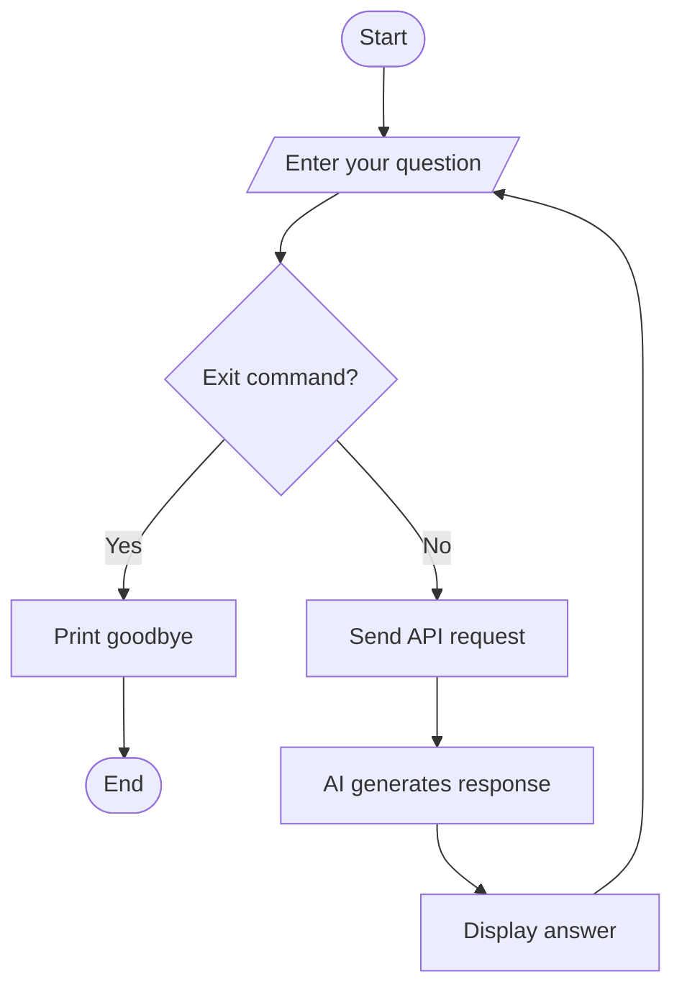

# 🚀 Day 1 — Introduction to AI Assistant

> Learn by coding. Understand by practising.

## 🎯 What I Learned

- 🤖 **AI Assistant:** Answers user questions.
- 🧠 **AI Agent:** Can use tools and perform multi-step tasks.
- 🔌 **API:** Allows Python to communicate with an AI model.
- 🦙 **Ollama:** Runs supported AI models locally.
- 🐍 **Python SDK:** Helps send requests to an AI API.

## 💻 Code Examples

| File | Purpose |
|---|---|
| `hello_ai.py` | Send a question to an AI model |
| `assistant.py` | Build an interactive AI assistant |

## 🔄 AI Assistant Flowchart



## ⚙️ Key Concepts

| Code | Purpose |
|---|---|
| `OpenAI()` | Create an API client |
| `load_dotenv()` | Load `.env` configuration |
| `os.getenv()` | Read environment variables |
| `input()` | Get user input |
| `while True` | Repeat a process |
| `break` | Exit a loop |
| `print()` | Display output |

## ▶️ How to Run

Install dependencies:

```bash
pip install openai python-dotenv
```

Run the programs:

```bash
python hello_ai.py
python assistant.py
```

**Prerequisite:** Configure `.env` with the correct API endpoint, credentials and model name.

## 📝 Quick Revision

- An API connects software systems.
- An AI assistant responds to user requests.
- An AI agent can use tools to achieve goals.
- The current assistant does not remember previous messages between requests.

## 🎯 Practice

1. Change the question in `hello_ai.py`.
2. Ask multiple questions in `assistant.py`.
3. Type `exit`, `quit`, or `bye` to stop the assistant.

---

**Progress:** Day 1 — Learning in Progress 🚀
