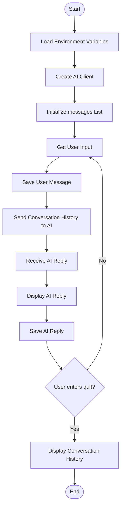

# 🤖 Day 2 — AI Assistant with Memory

## 🎯 Objective
Build an interactive AI assistant that remembers the conversation during the current session using Python lists and dictionaries.

## 🧠 Key Concepts
- **List (`messages`)** — stores conversation history.
- **Dictionary** — stores each message's `role` and `content`.
- **`append()`** — saves user and AI messages.
- **API Context** — sends conversation history to the AI.
- **`for` loop** — displays readable conversation history.
- **Session Memory** — memory resets when the program stops.

## 🔄 Code Flow



## 💻 Message Structure

```python
messages = [
    {"role": "user", "content": "Hello"},
    {"role": "assistant", "content": "Hi! How can I help?"}
]
```

## 📌 Day 2 Learning
**Day 1:** AI responds to the current input.

**Day 2:** AI receives the stored conversation history for contextual responses.

> Note: This is session-based memory, not permanent memory. The conversation is stored in RAM and is lost when the program ends.

## 🛠️ Technologies
Python • OpenAI-compatible API • python-dotenv • Lists • Dictionaries • Loops
