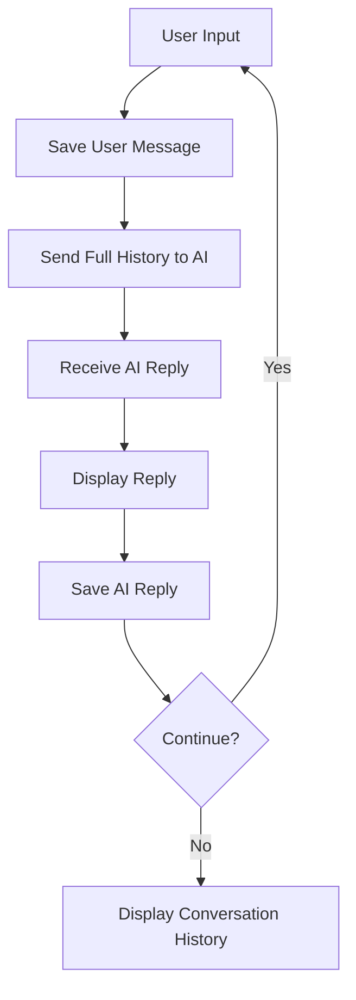

# 🤖 Day 2 — AI Assistant with Memory

## 🎯 Day 1 Problem
- AI received only the current user message.
- It could not remember previous conversations because chat history was not sent to the API.

## ✅ Day 2 Solution
- Created a `messages` list to store conversation history.
- Used dictionaries with `role` and `content` to identify each message.
- Used `messages.append()` to save user and AI messages.
- Sent the complete conversation history to the AI.
- Displayed conversation history in a readable format using a `for` loop and f-string.

## 🔄 Code Flow

## 🧠 Key Learning

**Day 1:** Single-message interaction — no conversation context.

**Day 2:** Session-based memory — AI can use previous messages for contextual responses.

## ⚠️ Limitation
Conversation history is stored in RAM and is lost when the program stops. Permanent memory requires file or database storage.

## 🛠️ Technologies
Python • OpenAI-compatible API • `python-dotenv` • Lists • Dictionaries • Loops • f-strings
