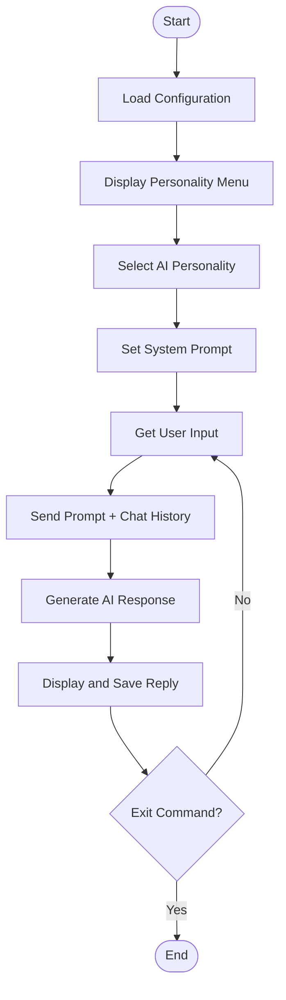

# 🤖 Day 3 — System Prompts & AI Personalities

## 🎯 Objective
Customize AI behaviour using system prompts and build an assistant with multiple selectable personalities.

## ⚠️ Previous Limitations
- **Day 1:** AI responded to user input without conversation memory.
- **Day 2:** AI remembered conversation history during the current session, but its behaviour was not configurable.

## ✅ What I Built
- Added a `roles` dictionary with five AI personalities.
- Implemented a menu to select an assistant.
- Used `roles.get()` to retrieve the selected system prompt.
- Added the system prompt to the conversation using `"role": "system"`.
- Preserved conversation history using a `messages` list.
- Added exit commands: `quit`, `exit`, and `bye`.

## 🧠 Key Concepts

| Concept | Purpose |
|---|---|
| System Prompt | Defines the AI's role and behaviour |
| Dictionary | Maps choices to personality instructions |
| `roles.get()` | Retrieves the selected personality |
| `role: system` | Supplies instructions to the AI |
| Conversation History | Maintains context during the session |

## 🔄 Code Flow

## 🎭 Available Personalities
1. Teacher — Simple explanations and real-life examples.
2. Python Expert — Programming guidance with code examples.
3. Travel Guide — Travel recommendations and tips.
4. Motivational Coach — Encouragement and practical advice.
5. Interviewer — Interview questions and feedback.

## 📌 Key Learning
**System Prompt = Instructions + Role + Behaviour**

One AI model can serve different purposes by changing its system prompt.

**Limitation:** The selected personality and conversation memory exist only for the current program session. Only one personality is selected at a time.

## 🛠️ Tech Stack
Python • OpenAI-compatible API • python-dotenv • Dictionaries • Lists • System Prompts
