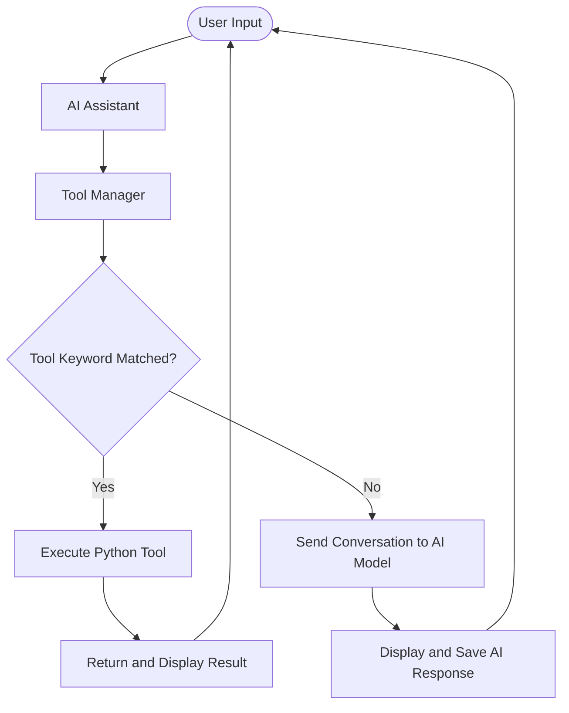

# 🤖 Day 4 — AI Assistant with Tools

## 🎯 Objective
Extend the AI assistant with Python tools while improving code organization through modular architecture and refactoring.

## ⚠️ Previous Limitations
- The assistant could respond to questions and adopt different personalities.
- It could maintain conversation context during the current session.
- It could not directly execute custom Python utility functions through a dedicated tool system.

## ✅ What I Built
- Created reusable Python tools for date/time, dice rolling, and password generation.
- Built a `tool_manager.py` module to identify tool requests and execute the appropriate function.
- Integrated tool execution into the AI assistant.
- Tested individual tools and tool routing using separate test files.
- Refactored code into separate modules with clear responsibilities.

## 🧠 Key Learnings

| Concept | What I Learned |
|---|---|
| AI Assistant with Tools | Extend an assistant with executable Python functions |
| AI Model vs. Tools | The AI model generates responses; Python tools execute predefined operations |
| Tools | Reusable functions that perform specific tasks |
| Refactoring | Improve code structure without changing its intended behaviour |
| SRP — Single Responsibility Principle | Give each module a clear, separate responsibility |

## 🔄 Code Flow



## 📁 Modular Architecture

```text id="r9l4ze"
Day-4/
├── assistant.py
├── tools.py
├── tool_manager.py
├── test_tools.py
├── test_tool_manager.py
└── README.md
```

- **`assistant.py`** — manages the AI conversation and integrates tools.
- **`tools.py`** — contains reusable utility functions.
- **`tool_manager.py`** — identifies matching tool requests and routes execution.
- **Test files** — verify tool functionality and routing.

## 🚀 AI Assistant Capabilities

- Remembers conversation context during the current session.
- Adopts different personalities through system prompts.
- Executes predefined Python utility tools.
- Can be extended with additional tools.
- Follows a modular code structure for easier maintenance.

## 📌 Key Takeaway

**A capable AI assistant combines an AI model, conversation history, executable tools, and clean software architecture.**

**Limitation:** Tool selection currently uses keyword matching rather than autonomous AI-driven tool selection. Conversation memory is session-based.

## 🛠️ Tech Stack
Python • OpenAI-compatible API • python-dotenv • Modular Programming • Refactoring • Single Responsibility Principle
