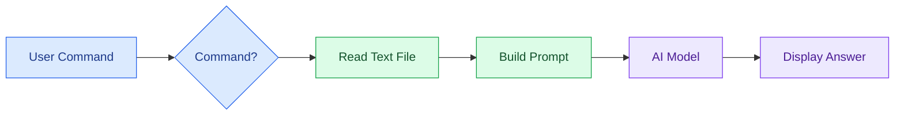

# 📄 Day 5 — AI Assistant with File Reading & Document Q&A

## 🎯 Objective
Extend the AI assistant to read text files, summarize documents, explain their content, and answer questions using document information.

## ⚠️ Previous Limitations
- The assistant could respond to general questions and use predefined Python tools.
- It could maintain conversation context during the current session.
- It could not read a document and answer questions based on its contents.

## ✅ What I Built
- Created `read_text_file()` to read text files.
- Added document commands: `summarize`, `explain`, and `ask`.
- Combined document content and user questions into a single prompt.
- Sent the prompt to the AI model and displayed its response.
- Added basic handling for files that cannot be found.

## 🧠 Key Learnings

| Concept | What I Learned |
|---|---|
| File Handling | Read text files using Python |
| Document Summarization | Generate concise document summaries |
| Document Explanation | Ask the AI to explain document content |
| Document Q&A | Combine document content with a specific question |
| Prompt Construction | Use an f-string to combine instructions, document, and question |
| Error Handling | Handle missing files using `FileNotFoundError` |

## 🔄 Code Flow



## 📁 Modular Architecture

```text
Day-5/
├── assistant.py
├── tools.py
├── tool_manager.py
├── test_file_tool.py
└── README.md
```

- **`assistant.py`** — handles commands, builds prompts, and calls the AI model.
- **`tools.py`** — provides reusable utilities, including `read_text_file()`.
- **`tool_manager.py`** — handles the existing keyword-based utility tools.
- **`test_file_tool.py`** — tests text-file reading.

## 🚀 Example Commands

```text
summarize python.txt
explain python.txt
ask python.txt What is a Python function?
```

Files are read from the `data/` directory in the current implementation.

## ⚠️ Limitations & Areas for Improvement

- **Text files only:** PDF and DOCX document parsing is not implemented in the supplied code.
- **Local files only:** Documents must be available in the expected local directory.
- **Basic error handling:** Missing files are handled, but other file-reading errors are not explicitly handled.
- **No document memory:** Document content is not stored in persistent memory.
- **Context limitations:** The complete file content is inserted into the prompt, which may not scale to large documents.
- **Basic command parsing:** Commands require the expected format; malformed `ask` commands may cause errors.
- **Document-grounding limitations:** The `ask` prompt instructs the model to use only the document and admit when information is missing, but the model's answer still needs verification.

## 📌 Key Takeaway

**Read a document → combine its content with instructions or a question → send the prompt to the AI → display the answer.**

## 🛠️ Tech Stack
Python • OpenAI-Compatible API • python-dotenv • File Handling • Prompt Engineering • Modular Programming
