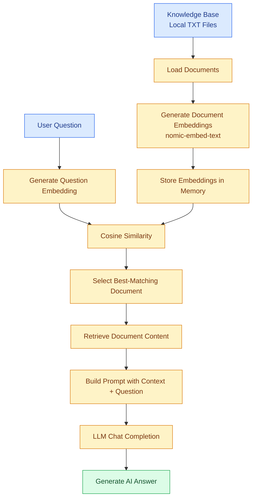

# 🧠 Day 6 — RAG Workflow | Semantic Search & Embeddings

## 🎯 Objective

Build a basic Retrieval-Augmented Generation (RAG) workflow that retrieves relevant information from local text documents using embeddings and cosine similarity, then uses an LLM to generate an answer based on the retrieved context.

## 🚀 What I Built

- Created a local knowledge base using `.txt` files.
- Loaded documents from the `knowledge/` folder.
- Generated document embeddings using **`nomic-embed-text`**.
- Converted user questions into embedding vectors.
- Compared question and document embeddings using cosine similarity.
- Retrieved the document with the highest similarity score.
- Combined retrieved context and user question into a prompt.
- Sent the prompt to an LLM and displayed its response.

## 🔄 RAG Workflow



## 📚 Key Concepts Learned

| Concept | Explanation |
|---|---|
| RAG | Retrieves relevant external information and provides it to an LLM as context. |
| Knowledge Base | Collection of documents used as the information source. |
| Embedding | Numerical vector representation of text. |
| Embedding Model | Converts text into embeddings. |
| Semantic Meaning | Meaning and context represented by text. |
| Cosine Similarity | Measures the similarity between two vectors based on their direction. |
| Semantic Search | Finds relevant content based on meaning rather than exact keyword matching. |
| Context | Retrieved information provided to the LLM. |

## 🤖 Embedding Model

**Model:** `nomic-embed-text`

Used to convert both knowledge-base documents and user questions into numerical vectors.

```python
embedding = client.embeddings.create(
    model="nomic-embed-text",
    input=content
).data[0].embedding
```

## 📐 Cosine Similarity

Cosine similarity compares the direction of two vectors.

\[
\text{Similarity}(A,B)=
\frac{A\cdot B}{\|A\|\|B\|}
\]

In this project:
- Vector A = User question embedding
- Vector B = Document embedding
- Higher score = Greater vector similarity

## 🛠️ Tech Stack

- Python
- OpenAI-compatible API
- Ollama
- `nomic-embed-text`
- NumPy
- Cosine Similarity
- LLM Chat Completion
- Python File Handling

## 📁 Project Structure

```text
Day-6/
│
├── knowledge/
│   └── *.txt
│
├── rag.py
├── retriever.py
├── similarity.py
├── test_embedding.py
├── test_retriever.py
├── .env
└── README.md
```

**Note:** Keep `.env` private. Never upload API keys or credentials to GitHub.

## ⚠️ Current Limitations

- Supports local `.txt` documents only.
- Each complete document is embedded as one vector; chunking is not implemented.
- Embeddings are stored in memory, not a vector database.
- Only the single highest-scoring document is selected.
- No minimum similarity threshold is implemented.
- The keyword-based `retrieve()` function is separate and is not used by the main `rag.py` workflow.
- Large documents may exceed the model's context limits.
- Retrieval quality and generated answers require testing.

## 💡 Key Takeaway

**RAG = Retrieve + Augment + Generate**

Instead of asking an LLM to answer only from its existing knowledge, this workflow retrieves a relevant local document, adds it to the prompt as context, and asks the LLM to generate an answer.

This is my Day 6 progress in learning AI Agent Development — understanding how embeddings, semantic similarity, retrieval, and LLMs work together in a basic RAG system.

---

*Learning step by step: From Basic AI Assistant to Advanced AI Agents.*