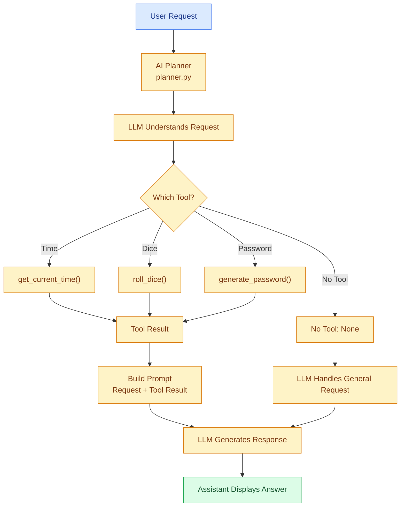

# 🤖 Day 7 — AI Agent with Planner & Tool Execution

## 🎯 Objective

Build a smarter AI assistant that understands user requests, selects appropriate Python tools using an LLM-based planner, executes the selected tools, and generates natural-language responses.

## 🚀 What I Built

- Created `planner.py` to make intelligent tool-selection decisions.
- Used an LLM to understand user requests and select the appropriate tool.
- Created `test_planner.py` to test different user requests.
- Connected the planner with the main AI assistant.
- Integrated Python tool execution based on planner decisions.
- Passed tool execution results back to the LLM.
- Enabled the assistant to generate natural-language responses using tool results.
- Added a fallback path for requests that do not require a tool.

## 🔄 Complete AI Agent Workflow



## 🧠 Key Concepts Learned

| Concept | Explanation |
|---|---|
| AI Planner | Uses an LLM to understand a request and select a tool. |
| Tool Selection | Determines which Python function should execute. |
| Tool Execution | Executes the selected Python function. |
| LLM-based Decision Making | Uses the model to interpret user intent instead of relying only on keywords. |
| Tool Result | Output returned by the executed Python function. |
| Prompt Construction | Combines the user request and tool result for the LLM. |
| Natural Language Response | Converts tool output into a human-readable answer. |
| Fallback Handling | Allows the LLM to handle requests when no tool is selected. |

## 🛠️ Available Tools

| Tool | Purpose |
|---|---|
| `get_current_time()` | Returns current date and time. |
| `roll_dice()` | Generates a random number between 1 and 6. |
| `generate_password()` | Generates a secure random password. |

## 🧪 Planner Testing

Created `test_planner.py` to test four different requests:

```python
from planner import choose_tool

print(choose_tool("What time is it?"))
print(choose_tool("Generate a password"))
print(choose_tool("Roll a dice"))
print(choose_tool("Explain Python"))
```

Expected planner decisions:

| User Request | Expected Result |
|---|---|
| What time is it? | `get_current_time` |
| Generate a password | `generate_password` |
| Roll a dice | `roll_dice` |
| Explain Python | `none` |

## 📁 Project Structure

```text
Day-7/
│
├── assistant.py
├── planner.py
├── test_planner.py
├── tools.py
├── .env
└── README.md
```

## 🛠️ Tech Stack

- Python
- OpenAI-compatible API
- Ollama
- Qwen3:1.7b
- Python-dotenv
- LLM-based planning
- Prompt Engineering
- Modular Programming

## ⚠️ Current Limitations

- The planner returns plain text rather than using native structured tool calling.
- Tool selection depends on the LLM returning an exact tool name.
- Unexpected planner output may cause the assistant to skip the intended tool.
- Tool execution supports only three tools in the current assistant.
- Tool results are not stored in persistent conversation memory.
- The assistant displays natural-language responses as text; audio or voice output is not implemented.
- The planner does not currently validate whether a tool call is safe or whether its arguments are valid.

## 💡 Key Takeaway

**Day 7: From Keyword-Based Routing to LLM-Based Planning**

Previously, the assistant selected tools using predefined keyword matching.

Now, an LLM-based planner understands the user's request and decides which Python tool should execute.

The overall process:

**User Request → AI Planner → Tool Selection → Tool Execution → Tool Result → LLM Response → Assistant Output**

This is an important foundation for developing more capable AI agents.

---

*Learning step by step: From Basic AI Assistant to Intelligent AI Agents.*