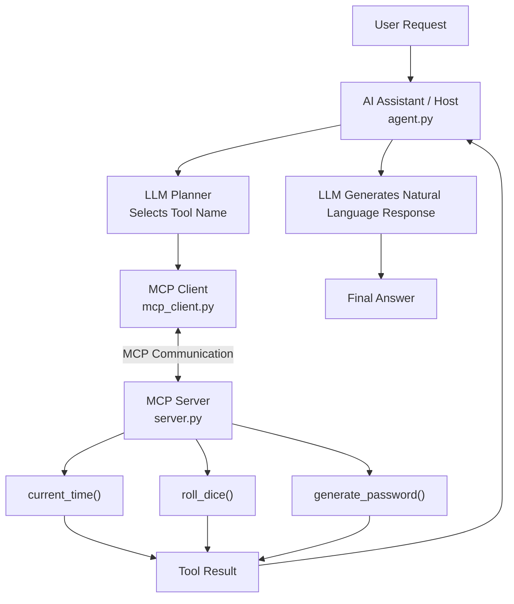

 
# Day 8 — MCP (Model Context Protocol) Integration

## 🎯 Objective

Integrate **MCP (Model Context Protocol)** into a Python AI assistant so that an LLM can discover and execute external tools through an MCP Client and MCP Server.

Instead of directly managing every tool inside the assistant, MCP provides a standard way to expose and access tools.

## 🧠 What I Learned

- What MCP is and why it is useful.
- MCP Host, Client, and Server architecture.
- Creating an MCP Server using **FastMCP**.
- Registering tools using `@mcp.tool()`.
- Connecting an AI assistant to an MCP Server.
- Discovering available tools dynamically.
- Executing tools through an MCP Client.
- Using `async` and `await` for asynchronous operations.
- Managing asynchronous execution using `asyncio.run()`.

## 🏗️ Architecture



## 📂 Project Structure

```text
Day-8/
│
├── agent.py          # Main AI assistant and LLM planner
├── mcp_client.py     # MCP connection and tool execution
├── server.py         # MCP server and tool definitions
├── test_client.py    # Tests connection, discovery and execution
└── README.md         # Day 8 documentation
```

## ⚙️ How It Works

### 1. MCP Server — `server.py`

Created an MCP Server using FastMCP.

Registered three tools:

| Tool | Function |
|---|---|
| `current_time()` | Returns current date and time |
| `roll_dice()` | Generates a random number from 1 to 6 |
| `generate_password()` | Generates a random password |

Used the `@mcp.tool()` decorator to expose Python functions as MCP tools.

### 2. MCP Client — `mcp_client.py`

Created an MCP Client using `fastmcp.Client`.

Implemented four operations:

- `connect()` — Connects to the MCP Server.
- `disconnect()` — Closes the connection.
- `discover_tools()` — Retrieves available tools.
- `execute_tool()` — Calls a selected tool and returns its result.

### 3. AI Assistant — `agent.py`

The main assistant follows this workflow:

1. Connects to the MCP Server.
2. Discovers available tools.
3. Displays the available tools.
4. Receives a user request.
5. Sends tool descriptions and the user request to the LLM planner.
6. Receives a tool name from the LLM.
7. Executes the selected tool through the MCP Client.
8. Sends the tool result back to the LLM.
9. Generates and displays a natural-language response.

### 4. Testing — `test_client.py`

Created a separate test script to verify:

- MCP Server connection.
- Tool discovery.
- Tool execution using `roll_dice`.
- Tool result retrieval.

## 🔑 Important Concepts

| Concept | Meaning |
|---|---|
| MCP | A standard protocol for connecting AI applications with external tools and context |
| MCP Host | The AI application that uses MCP |
| MCP Client | Connects the host to an MCP Server |
| MCP Server | Exposes tools to MCP Clients |
| FastMCP | Python framework used to build MCP Servers |
| `@mcp.tool()` | Registers a Python function as an MCP tool |
| `async` | Defines an asynchronous function |
| `await` | Waits for an asynchronous operation to complete |
| `asyncio.run()` | Runs an asynchronous entry-point function |

## 🔄 Day 7 vs Day 8

| Day 7 | Day 8 |
|---|---|
| Tools managed directly in Python | Tools exposed through an MCP Server |
| Direct tool execution | MCP Client executes tools |
| Tool management inside the project | Separate client and server responsibilities |
| Basic LLM-based planner | LLM planner connected to MCP tools |

## ⚠️ Current Limitations

- The planner selects tools using plain-text tool names, not native structured tool calling.
- The LLM does not generate tool arguments.
- Tool execution currently passes no arguments from the planner.
- Tool names are not validated against the discovered tool list before execution.
- Only one user request is processed per run.
- No persistent conversation memory is implemented.
- MCP Resources and Prompts are not implemented.
- `test_client.py` tests the client workflow, not the complete LLM planning workflow.
- Connection cleanup is not protected by `try/finally` if an exception occurs.

## 🚀 Future Improvements

- Add LLM-generated tool arguments.
- Validate tool selection against discovered tools.
- Add error handling and reliable connection cleanup.
- Support multiple user requests in one session.
- Integrate MCP Resources and Prompts.
- Add conversation memory.
- Build a more flexible multi-tool AI agent.

## 💡 Key Takeaway

**Day 8 taught me how to connect an AI assistant with external tools using MCP.**

The assistant can discover tools from an MCP Server and execute them through an MCP Client. This separates the AI assistant from the tools it uses and introduces a more standardized architecture for building AI agents.

---

**Technologies:** Python | Ollama | Qwen 3 | FastMCP | MCP | OpenAI-Compatible API | Asyncio

**Learning Journey:** AI Agent Development — From Zero to AI Agents

**Next:** Day 9 — Coming Soon 🚀