# 🤖 AI Agent Development — From Zero to AI Agents

**A day-by-day practical journey to learn AI, LLMs, and AI Agent Development using Python.**

Building AI applications step by step — from basic AI assistants to conversation memory, configurable personalities, Python tool integration, and document-based question answering.

---

## 🎯 Project Goal

Learn AI Agent Development through hands-on coding, understand each concept, identify limitations, and progressively build more capable AI applications using Python.

## 📚 Daily Learning Roadmap

| Day | Topic | What I Learned | Status |
|---|---|---|---|
| Day 1 | Basic AI Assistant | API integration, user input, AI responses | ✅ Completed |
| Day 2 | AI Assistant with Memory | Lists, dictionaries, conversation history | ✅ Completed |
| Day 3 | System Prompts & AI Personalities | Custom instructions and configurable behaviour | ✅ Completed |
| Day 4 | AI Assistant with Tools | Python tools, tool manager, refactoring, SRP | ✅ Completed |
| Day 5 | File Reading & Document Q&A | Read text files, summarize, explain, answer questions | ✅ Completed |
| Day 6 | Coming Next | To be updated | ⏳ Upcoming |

---

## 🧠 Learning Progress

### Day 1 — Basic AI Assistant

- Connected Python to an OpenAI-compatible API.
- Loaded credentials using `.env` and `python-dotenv`.
- Built a basic and interactive AI assistant.
- Learned how to send user messages and display AI responses.

**Limitation:** Previous conversation history was not sent to the AI.

[📂 Explore Day 1 →](./Day-1/README.md)

### Day 2 — AI Assistant with Memory

- Stored conversation messages in a Python list.
- Used dictionaries to identify `role` and `content`.
- Saved user messages and AI replies using `append()`.
- Sent conversation history to the AI for contextual responses.
- Displayed stored messages in a readable chat format.

**Limitation:** Session memory is lost when the program stops.

[📂 Explore Day 2 →](./Day-2/README.md)

### Day 3 — System Prompts & AI Personalities

- Created five selectable AI personalities using a dictionary.
- Used `roles.get()` to retrieve personality instructions.
- Added system instructions using `"role": "system"`.
- Configured the AI's role, tone, and response behaviour.
- Combined system instructions with conversation history.

**Limitation:** Only one personality is selected at a time, and settings are not permanently saved.

[📂 Explore Day 3 →](./Day-3/README.md)

### Day 4 — AI Assistant with Tools

- Created reusable Python tools for date/time, dice rolling, and password generation.
- Built `tool_manager.py` to identify matching requests and execute tools.
- Integrated tool execution into the AI assistant.
- Tested utility functions and tool routing using separate test files.
- Refactored code into modules with separate responsibilities.
- Learned **Refactoring** and the **Single Responsibility Principle (SRP)**.

**Limitation:** Tool selection uses keyword matching rather than AI-driven tool calling. Tool results are not saved in conversation history, and memory remains session-based.

[📂 Explore Day 4 →](./Day-4/README.md)

### Day 5 — File Reading & Document Q&A

- Created `read_text_file()` to read local text files.
- Added commands to summarize and explain document content.
- Implemented document-based questions using the `ask` command.
- Combined document content, instructions, and questions into a single prompt.
- Sent the prompt to the AI model and displayed the response.
- Added basic handling for missing files.

**Limitation:** The current implementation reads text files only. PDF/DOCX parsing, persistent document memory, and advanced handling of large documents are not implemented.

[📂 Explore Day 5 →](./Day-5/README.md)

---

## 🚀 Project Evolution — Interactive Roadmap

**From basic AI responses to document-aware, tool-enabled assistants.**

Follow the development journey and select a completed stage to explore its learning notes.

```mermaid id="r8v4k2"
flowchart LR
    START(["🚀 AI Agent<br/>Development"])
    D1["DAY 1<br/>Basic AI Assistant"]
    D2["DAY 2<br/>Session Memory"]
    D3["DAY 3<br/>AI Personalities"]
    D4["DAY 4<br/>Python Tools & SRP"]
    D5["DAY 5<br/>Document Q&A"]
    NEXT["DAY 6<br/>Coming Next"]
    GOAL(["🎯 Advanced<br/>AI Agents"])

    START --> D1 --> D2 --> D3 --> D4 --> D5 --> NEXT --> GOAL

    click D1 "./Day-1/README.md" "Explore Day 1"
    click D2 "./Day-2/README.md" "Explore Day 2"
    click D3 "./Day-3/README.md" "Explore Day 3"
    click D4 "./Day-4/README.md" "Explore Day 4"
    click D5 "./Day-5/README.md" "Explore Day 5"

    classDef start fill:#172554,stroke:#60a5fa,color:#ffffff,stroke-width:2px
    classDef completed fill:#dcfce7,stroke:#16a34a,color:#14532d,stroke-width:2px
    classDef upcoming fill:#fef3c7,stroke:#d97706,color:#78350f,stroke-width:2px
    classDef future fill:#dbeafe,stroke:#2563eb,color:#1e3a8a,stroke-width:2px

    class START start
    class D1,D2,D3,D4,D5 completed
    class NEXT upcoming
    class GOAL future
```



### 🔄 How Each Day Improves the Assistant

| Stage | Capability | Improvement |
|---|---|---|
| Day 1 | AI Responses | Connect Python to an AI model |
| Day 2 | Session Memory | Provide previous messages as context |
| Day 3 | Configurable Behaviour | Customize responses using system prompts |
| Day 4 | Python Tool Integration | Execute predefined functions using keyword-based routing |
| Day 5 | Document Q&A | Read text files and answer document-based questions |
| Future | Advanced AI Agents | Progress toward AI-driven tool selection, planning, and task execution |

---

## 🛠️ Tech Stack

- **Language:** Python
- **AI Integration:** OpenAI-compatible API
- **Configuration:** `python-dotenv` and environment variables
- **Core Concepts:** Lists, dictionaries, loops, f-strings, functions, system prompts, conversation history, file handling, prompt construction
- **Architecture:** Tool management, modular programming, refactoring, Single Responsibility Principle (SRP)
- **Testing:** Python test scripts for tools and file reading
- **Tools:** Visual Studio Code, Git, and GitHub
- **Documentation:** Markdown and Mermaid

## 📁 Repository Structure

```text id="t6z3b1"
AI-AGENT-DEVELOPMENT/
├── Day-1/
│   ├── assistant.py
│   ├── hello_ai.py
│   └── README.md
├── Day-2/
│   ├── assistant.py
│   └── README.md
├── Day-3/
│   ├── assistant.py
│   └── README.md
├── Day-4/
│   ├── assistant.py
│   ├── tools.py
│   ├── tool_manager.py
│   ├── test_tools.py
│   ├── test_tool_manager.py
│   └── README.md
├── Day-5/
│   ├── assistant.py
│   ├── tools.py
│   ├── tool_manager.py
│   ├── test_file_tool.py
│   └── README.md
├── .gitignore
└── README.md
```

*Keep this structure aligned with the files actually present in the repository.*

---

## 🚀 Learning Approach

1. Understand the concept.
2. Write and run the code.
3. Identify limitations.
4. Improve the implementation.
5. Document each day's learning in its README.
6. Update this Master README and push changes to GitHub.

## 📌 Important Notes

- This repository documents my practical learning journey.
- Each day builds on previously learned concepts.
- Conversation memory currently lasts only for the active session.
- Day 4 tool execution is based on keyword matching.
- Day 5 document processing currently supports local text files only.
- Never upload `.env` files or API keys to GitHub.

---

**Consistency • Practical Learning • Continuous Improvement** 🚀
