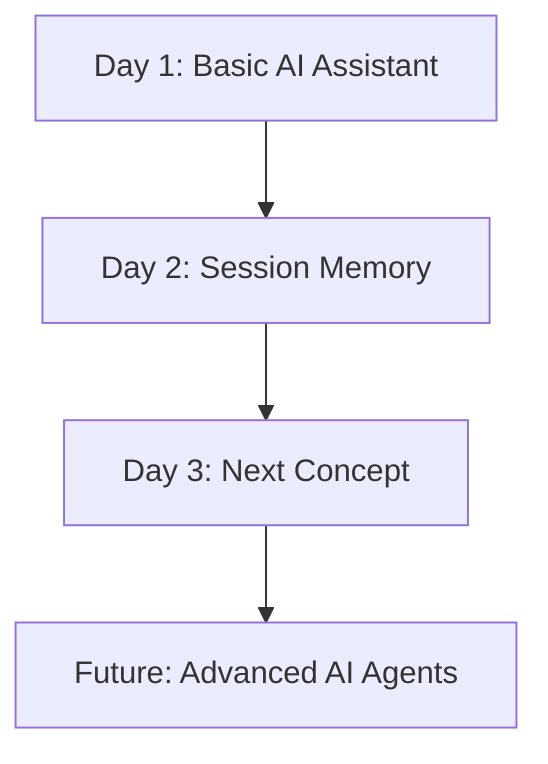

# 🤖 AI Agent Development — From Zero to AI Agents

**A day-by-day practical journey to learn AI, LLMs, and AI Agent Development using Python.**

## 🎯 Project Goal

Build AI applications step by step, starting with a basic AI assistant and progressing toward intelligent agents.

## 📚 Daily Learning Roadmap

| Day | Topic | What I Learned | Status |
|---|---|---|---|
| Day 1 | Basic AI Assistant | API setup, user input, AI responses | ✅ Completed |
| Day 2 | AI Assistant with Memory | Lists, dictionaries, conversation history | ✅ Completed |
| Day 3 | Coming Next | To be updated | ⏳ Upcoming |

## 🧠 Learning Progress

### Day 1 — Basic AI Assistant
- Connected Python to an OpenAI-compatible API.
- Loaded credentials using `.env` and `python-dotenv`.
- Built a basic and interactive AI assistant.
- **Limitation:** Previous conversation history was not sent to the AI.

### Day 2 — AI Assistant with Memory
- Stored messages in a Python list.
- Used dictionaries to identify `role` and `content`.
- Saved both user messages and AI replies using `append()`.
- Sent conversation history to the AI for contextual responses.
- Displayed chat history in a readable format.
- **Limitation:** Memory exists only while the program is running.

## 🔄 Project Evolution



## 🛠️ Tech Stack

- **Language:** Python
- **AI Integration:** OpenAI-compatible API
- **Configuration:** python-dotenv
- **Core Concepts:** Lists, dictionaries, loops, functions, conversation history
- **Tools:** Git and GitHub

## 📁 Repository Structure

```text
AI-AGENT-DEVELOPMENT/
├── Day-1/
│   ├── assistant.py
│   ├── hello_ai.py
│   └── README.md
├── Day-2/
│   └── README.md
├── .gitignore
└── README.md
```

*The structure will expand as new days and projects are added.*

## 🚀 Learning Approach

1. Understand the concept.
2. Write code and run it.
3. Identify limitations.
4. Improve the implementation.
5. Document the learning in that day's README.
6. Update this Master README and push changes to GitHub.

## 📌 Important Note

This repository documents my practical learning journey. Each day builds on previous concepts, with a focus on understanding the code and developing real-world AI applications.

---

**Consistency • Practical Learning • Continuous Improvement** 🚀
