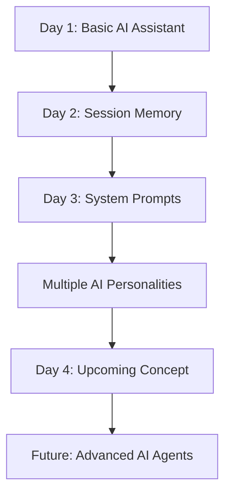

# 🤖 AI Agent Development — From Zero to AI Agents

**A day-by-day practical journey to learn AI, LLMs, and AI Agent Development using Python.**

## 🎯 Project Goal

Build AI applications step by step, progressing from a basic AI assistant to memory-enabled assistants, configurable AI personalities, and eventually advanced AI agents.

## 📚 Daily Learning Roadmap

| Day | Topic | What I Learned | Status |
|---|---|---|---|
| Day 1 | Basic AI Assistant | API integration and AI responses | ✅ Completed |
| Day 2 | AI Assistant with Memory | Lists, dictionaries, and conversation history | ✅ Completed |
| Day 3 | System Prompts & AI Personalities | Custom instructions and configurable behaviour | ✅ Completed |
| Day 4 | Coming Next | To be updated | ⏳ Upcoming |

## 🧠 Learning Progress

### Day 1 — Basic AI Assistant
- Connected Python to an OpenAI-compatible API.
- Loaded configuration using `.env` and `python-dotenv`.
- Built a basic and interactive AI assistant.
- **Limitation:** Previous conversation history was not sent to the AI.

### Day 2 — AI Assistant with Memory
- Stored messages in a Python list.
- Used dictionaries to identify `role` and `content`.
- Saved user messages and AI replies using `append()`.
- Sent conversation history to the AI for contextual responses.
- Displayed chat history in a readable format.
- **Limitation:** Memory exists only while the program is running.

### Day 3 — System Prompts & AI Personalities
- Created five selectable AI personalities using a dictionary.
- Used `roles.get()` to retrieve personality instructions.
- Added a system prompt using `"role": "system"`.
- Configured the AI's role, tone, and response behaviour.
- Combined system instructions with conversation history.
- **Limitation:** Only one personality is selected at a time, and settings are not permanently saved.

## 🔄 Project Evolution



## 🛠️ Tech Stack

- **Language:** Python
- **AI Integration:** OpenAI-compatible API
- **Configuration:** `python-dotenv` and environment variables
- **Core Concepts:** Lists, dictionaries, loops, f-strings, system prompts, conversation history
- **Tools:** Visual Studio Code, Git, and GitHub

## 📁 Repository Structure

```text
AI-AGENT-DEVELOPMENT/
├── Day-1/
│   ├── assistant.py
│   ├── hello_ai.py
│   └── README.md
├── Day-2/
│   ├── assistant.py
│   └── README.md
├── Day-3/
│   ├── assistant.py
│   └── README.md
├── .gitignore
└── README.md
```

*The repository structure will expand as new days and projects are added.*

## 🚀 Learning Approach

1. Understand the concept.
2. Write and run the code.
3. Identify limitations.
4. Improve the implementation.
5. Document each day's learning in its README.
6. Update this Master README and push changes to GitHub.

## 📌 Important Note

This repository documents my practical learning journey. Each day builds on previous concepts, with a focus on understanding the code, improving AI applications, and developing real-world AI agent development skills.

---

**Consistency • Practical Learning • Continuous Improvement** 🚀
