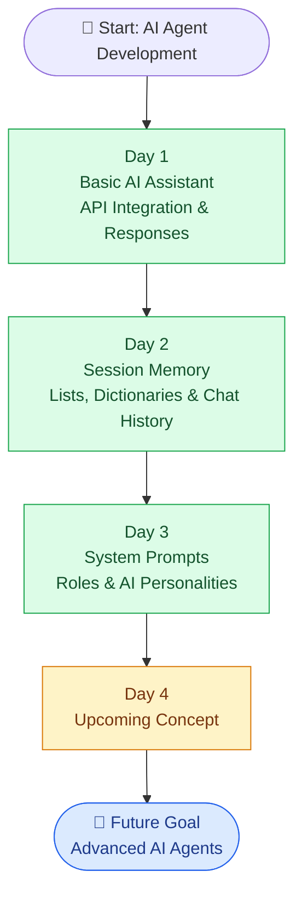

# 🤖 AI Agent Development — From Zero to AI Agents

**A day-by-day practical journey to learn AI, LLMs, and AI Agent Development using Python.**

Building AI applications step by step — from basic AI assistants to memory-enabled conversations and configurable AI personalities.

---

## 🎯 Project Goal

Learn AI Agent Development through hands-on coding, understand each concept, identify limitations, and progressively build more capable AI applications.

## 📚 Daily Learning Roadmap

| Day | Topic | What I Learned | Status |
|---|---|---|---|
| Day 1 | Basic AI Assistant | API integration, user input, AI responses | ✅ Completed |
| Day 2 | AI Assistant with Memory | Lists, dictionaries, conversation history | ✅ Completed |
| Day 3 | System Prompts & AI Personalities | Custom instructions and configurable behaviour | ✅ Completed |
| Day 4 | Coming Next | To be updated | ⏳ Upcoming |

---

## 🧠 Learning Progress

### Day 1 — Basic AI Assistant

- Connected Python to an OpenAI-compatible API.
- Loaded credentials using `.env` and `python-dotenv`.
- Built a basic and interactive AI assistant.
- Learned how to send user messages and display AI responses.

**Limitation:** Previous conversation history was not sent to the AI.

[📂 Explore Day 1 →](./Day-1/README.md)

### Day 2 — AI Assistant with Memory

- Stored conversation messages in a Python list.
- Used dictionaries to identify `role` and `content`.
- Saved user messages and AI replies using `append()`.
- Sent conversation history to the AI for contextual responses.
- Displayed stored messages in a readable chat format.

**Limitation:** Session memory is lost when the program stops.

[📂 Explore Day 2 →](./Day-2/README.md)

### Day 3 — System Prompts & AI Personalities

- Created five selectable AI personalities using a dictionary.
- Used `roles.get()` to retrieve personality instructions.
- Added system instructions using `"role": "system"`.
- Configured the AI's role, tone, and response behaviour.
- Combined system instructions with conversation history.

**Limitation:** One personality is selected at a time, and settings are not permanently saved.

[📂 Explore Day 3 →](./Day-3/README.md)

---

## 🚀 Project Evolution — Interactive Roadmap

Explore the progression from a basic assistant toward advanced AI agents. Select a completed day in the diagram to open its learning notes where Mermaid links are supported.



### 🔄 How Each Day Improves the Assistant

| Stage | Capability | Improvement |
|---|---|---|
| Day 1 | AI Responses | The assistant can answer user questions |
| Day 2 | Session Memory | The assistant can use previous messages as context |
| Day 3 | Configurable Behaviour | The assistant can follow different role instructions |
| Future | Advanced AI Agents | Progress toward tool use, planning, and task execution |

---

## 🛠️ Tech Stack

- **Language:** Python
- **AI Integration:** OpenAI-compatible API
- **Configuration:** `python-dotenv` and environment variables
- **Core Concepts:** Lists, dictionaries, loops, f-strings, system prompts, conversation history
- **Tools:** Visual Studio Code, Git, and GitHub
- **Documentation:** Markdown and Mermaid

## 📁 Repository Structure

```text
AI-AGENT-DEVELOPMENT/
├── Day-1/
│   ├── assistant.py
│   ├── hello_ai.py
│   └── README.md
├── Day-2/
│   ├── assistant.py
│   └── README.md
├── Day-3/
│   ├── assistant.py
│   └── README.md
├── .gitignore
└── README.md
```

*This structure represents the intended organization. Keep it aligned with the files actually present in the repository.*

---

## 🚀 Learning Approach

1. Understand the concept.
2. Write and run the code.
3. Identify limitations.
4. Improve the implementation.
5. Document each day's learning in its README.
6. Update this Master README and push changes to GitHub.

## 📌 Important Notes

- This repository documents my practical learning journey.
- Each day builds on concepts learned previously.
- Conversation memory currently lasts only for the active session.
- Never upload `.env` files or API keys to GitHub.

---

**Consistency • Practical Learning • Continuous Improvement** 🚀
